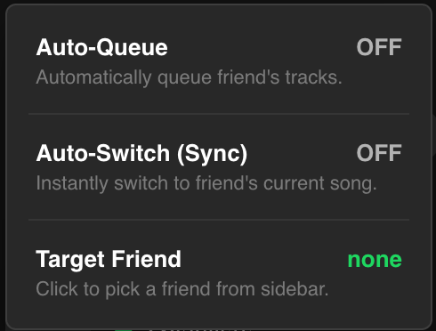

# 👥 Friend Auto-Queue & Sync

<p align="center">
  
</p>

Friend Auto-Queue is a native Spicetify extension that monitors your Spotify Friend Activity sidebar and automatically mirrors your friends' listening sessions. It adds a seamless control button directly to your upper topbar layout next to the Marketplace icon, letting you either auto-queue tracks as they play or instantly sync and jump straight to whatever song your target friend is listening to.

## ✨ Features

- **Automated Queueing:** Automatically captures tracks played by your chosen friend and appends them directly to your playlist queue.
- **Live Auto-Switch Sync:** Instantly overrides your current playback to match your friend's song change in real-time.
- **Dynamic Friend Selector:** Click the topbar icon to pick any active friend directly from your live sidebar dropdown list.
- **Persistent State Storage:** Remembers your target preference and toggle settings across app restarts via `Spicetify.LocalStorage`.
- **Theme-Agnostic Design:** Inherits your native application layout variables, fonts, borders, and dark-mode styles right out-of-the-box.

## 🚀 Installation

### Method 1: Via Spicetify Marketplace (Recommended)
1. Open your Spotify client app.
2. Click on the **Marketplace** icon in your top navigation panel.
3. Use the search bar to look up **`Friend Auto-Queue`**.
4. Click the **Install** button on the extension card to add it to your configuration automatically.

### Method 2: Manual Local Installation
If you prefer a manual setup or want to test custom modifications:
1. Download `friend-auto-queue.js` and move it to your Spicetify Extensions directory:
  - **Windows:** `%userprofile%\.spicetify\Extensions\`
  - **macOS/Linux:** `~/.spicetify/Extensions/`
2. Open your terminal or PowerShell window and run the standard initialization commands:
   ```bash
   spicetify config extensions friend-auto-queue.js
   spicetify apply
   ```

## ⚙️ How to Use

- **Left-Click the Icon:** Open the control dropdown panel to manage your session.
- **Toggle Modes:** Enable **Auto-Queue** to stack tracks, or turn on **Auto-Switch (Sync)** to mirror live playback instantly.
- **Select Target Friend:** Click the **Target Friend** menu row to dynamically map your feed to any user currently visible in your Friend Activity sidebar.

---

### ⚠️ Attributions Disclaimer
The actual extension source engine code and implementation parameters were programmed manually by the repository owner. Artificial Intelligence (AI) assistance was utilized strictly for drafting, structuring, and formatting the documentation layout inside this `README.md` asset page.
